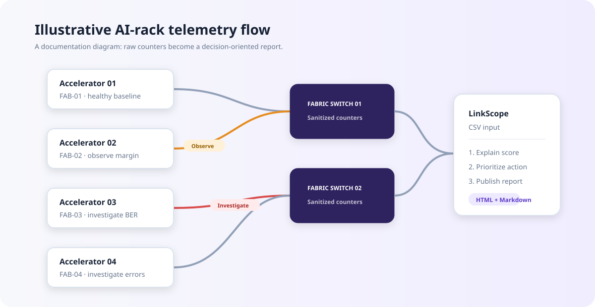

# LinkScope Docs

**A docs-as-code portfolio project for high-speed AI-infrastructure telemetry.**

LinkScope converts a small, fictional link-telemetry data set into a customer-ready health report. It is designed to demonstrate the blend of technical depth, information architecture, troubleshooting, and publishing automation needed for product documentation in the semiconductor and AI-infrastructure space.

> This is an independent portfolio project. All product names, device IDs, limits, and telemetry are illustrative; no Astera Labs confidential information or product behavior is represented.

## What it demonstrates

| Documentation competency | Where to review it |
| --- | --- |
| Task-based user guidance | [Quick start](docs/guide/quickstart.md) |
| Reference design | [Telemetry schema](docs/reference/telemetry-schema.md) |
| Troubleshooting content | [Troubleshooting guide](docs/guide/troubleshooting.md) |
| Visual system explanation | [AI-rack link map](docs/assets/ai-rack-link-map.svg) |
| Reproducible publishing | `linkscope.py` and the generated reports |
| Content standards and contribution workflow | [Contributor guide](CONTRIBUTING.md) and [style guide](docs/style-guide.md) |

## Why this problem

At rack scale, a weak high-speed link can surface as a vague customer symptom—retries, reduced bandwidth, or an intermittent training failure. The useful document is not simply a register dump: it helps an operator decide **what to check, how urgent it is, and what evidence to share with support**.

LinkScope demonstrates that documentation pattern using CSV telemetry: it calculates a transparent health score, turns findings into prioritized actions, and emits both Markdown and standalone HTML for review or publication.



## Quick start

Requirements: Python 3.10+; no third-party packages.

```bash
python3 linkscope.py --input samples/link_telemetry.csv --output reports
open reports/link-health-report.html
```

Run the built-in checks:

```bash
python3 -m unittest discover -s tests -v
```

## Example outcome

The included sample produces a report for four fictional fabric links:

- **Healthy** links need no action.
- **Observe** links have a trend worth checking at the next maintenance window.
- **Investigate** links include specific, customer-safe evidence to collect before escalation.

The scoring rules are intentionally visible in [the reference](docs/reference/telemetry-schema.md#health-classification). That makes the output explainable, reviewable, and easy for subject-matter experts to revise.

## Repository layout

```text
linkscope-docs/
├── docs/                 # Human-authored product documentation
├── samples/              # Fictional, shareable input data
├── tests/                # Verification of the reporting logic
├── reports/              # Generated publication artifacts
├── linkscope.py          # Dependency-free report generator
└── CONTRIBUTING.md       # Docs review and publishing workflow
```

## Publish on GitHub

1. Create an empty public repository named `linkscope-docs`.
2. From this directory, run `git init`, add the files, and push to GitHub.
3. Pin the repository on your profile with this description:

   `Docs-as-code sample: turns fictional high-speed link telemetry into an explainable health report, with task guides, a reference, and troubleshooting.`

4. In your application, link directly to this README and mention the generated [HTML report](reports/link-health-report.html).

## License

MIT. See [LICENSE](LICENSE).
